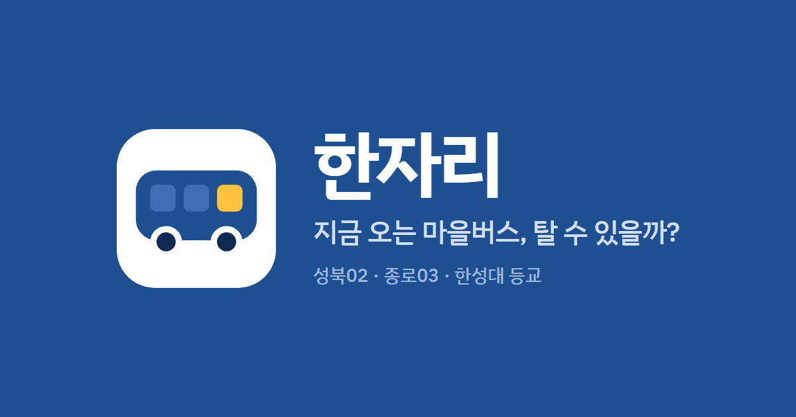
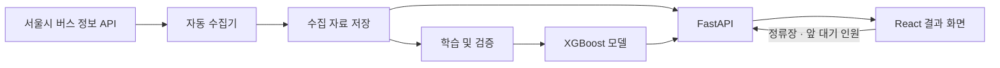

<div align="center">



<br>

**한성대학교 통학생을 위한 버스 탑승 가능성 안내 서비스**

정류장을 선택하고 내 앞 대기 인원을 입력하면<br>
첫 번째 도착 예정 버스의 정보와 AI가 예측한 탑승 확률을 확인할 수 있습니다.

<br>


**[🚌 서비스 바로가기](http://161.33.132.80:8000/)**

한성대학교 오픈소스 AI·SW 융합 프로젝트 · **팀 얼리액세스**

[소개](#-프로젝트-소개) · [기능](#-주요-기능) · [실행](#-내-pc에서-실행하기) · [기술](#-기술-및-구조) · [OSS](#-오픈소스와-라이선스) · [검증](#-검증-목표) · [팀](#-팀-소개) · [일정](#-진행-계획)

</div>

---

## 📌 프로젝트 소개

버스가 언제 오는지 알아도 **이번 버스에 탈 수 있을지**는 판단하기 어렵습니다. 차량 안의 승객 수와 내 앞에서 기다리는 사람 수에 따라 탑승 가능성이 달라지기 때문입니다.

한자리는 도착 정보에 **차량 혼잡도와 대기 순서를 고려한 탑승 가능성**을 더합니다. 학생이 대기를 계속할지, 다른 이동 방법을 고려할지 판단하도록 돕는 것이 목표입니다.

### 이용 대상과 범위

| 제공하는 것 | 제공하지 않는 것 |
| --- | --- |
| 성북02·종로03 **등교 방향 정류장 6곳** | 그 밖의 노선·정류장, 하교 방향 |
| **월~토요일** 예측 (공휴일 제외) | 일요일·공휴일 예측 |
| 정류장에서 대기 중일 때, 조회 시점의 첫 번째 버스 탑승 가능성 | 걸어가는 시간을 포함한 개인별 도착 전 탑승 예측 |
| 내 앞 대기 인원 직접 입력 (0~40명) | 대기열 자동 촬영, 위치 추적, 개인 식별정보 수집 |
| 로그인 없는 모바일·PC 반응형 웹 | 네이티브 앱, 로그인, 결제, 좌석 예약 |

> [!NOTE]
> 예측 결과는 이동 판단을 돕는 **참고 정보이며 실제 탑승을 보장하지 않습니다.**

## ✨ 주요 기능

| 기능 | 제공 내용 |
| --- | --- |
| 정류장 선택 | 성북02·종로03 등교 방향 6개 정류장 조회, 마지막 선택 정류장 저장 |
| 대기 인원 입력 | 내 앞 대기 인원 **0~40명**의 정수 입력, 변경 후 **0.25초** 뒤 재조회 |
| 첫 번째 버스 정보 | 도착 예정 시간, 차량·현재 승객 수·남은 정류장·갱신 시각 |
| 탑승 가능성 안내 | 예측 확률과 ‘여유 있음’, ‘빠듯함’ 등의 안내 |
| 자동 갱신 | 정상 상태에서 **30초마다** 갱신, 오류 시 **60초** 후 재시도 |

### 예측을 보류하는 경우

정확하지 않은 확률을 보여주지 않도록, 아래 상황에서는 확률을 숨기거나 판단을 유보합니다.

- 수집 자료가 **180초를 초과**하면 확률과 도착시간 카운트다운을 숨김
- 일요일·공휴일, 검증이 부족한 경우 확률 보류
- 예상 승객 수의 10~90% 범위 폭이 **20명을 초과**하면 판단 유보
- 빈칸·문자·소수·범위 밖 입력이면 예측을 숨기고 입력 안내
- 응답이 **8초** 이상 지연되거나 서버 장애가 있으면 상태 안내

### 보완·구현 예정

- [ ] **상태 안내 보완** (9주차): 운행 종료, 도착 버스 없음, 수집 오류 등 빈 결과의 원인 구분
- [ ] **익명 탑승 결과 기록** (10주차): 기록 규칙 확정, API·화면·저장 기능 구현 예정. 참여 동의와 보관기간은 결정 예정
- [ ] **HTTPS 적용과 복구 검증** (10~11주차): 현재 HTTP로 운영 중
- [ ] **두 번째 버스 도착 정보**: 요구사항으로 유지하고 있으며 현재 보류 중

## 🚀 내 PC에서 실행하기

**Python 3.11**이 필요합니다. 저장소를 내려받은 뒤 최상위 폴더에서 실행하세요.

**Windows PowerShell**

```powershell
py -3.11 -m venv .venv
.\.venv\Scripts\python.exe -m pip install -r requirements-runtime.txt
.\.venv\Scripts\python.exe scripts/run_local.py
```

<details>
<summary><b>macOS · Linux</b></summary>

```sh
python3.11 -m venv .venv
.venv/bin/python -m pip install -r requirements-runtime.txt
.venv/bin/python scripts/run_local.py
```

</details>

브라우저에서 [http://127.0.0.1:8000](http://127.0.0.1:8000)을 열면 됩니다. 종료는 `Ctrl+C`입니다.

> [!TIP]
> 기본 실행은 **API 키가 필요 없는 샘플 모드**입니다. 2026년 9월 30일 저장 자료를 사용하므로 현재 버스 상황과는 다르며, 실시간 수집이나 자동 학습은 시작하지 않습니다.

> [!WARNING]
> `hanjari/src/collect.py`(수집기)와 `hanjari-ml/ops/install.sh`는 **운영 서버 전용**입니다. 다른 곳에서 실행하면 API 하루 한도를 넘기거나 시스템 설정이 바뀝니다.

화면 수정과 빌드는 [프론트엔드 개발 안내](hanjari-web/frontend/README.md), 실시간 조회 설정은 [운영 안내](deployment/README.md)를 참고하세요.

## 🛠 기술 및 구조

사용자가 조회할 때마다 외부 버스 API를 호출하지 않고, **미리 수집해 저장한 자료**로 탑승 가능성을 계산합니다.



| 구분 | 주요 기술 | 역할 |
| --- | --- | --- |
| Frontend | React · TypeScript · Vite | 정류장 선택, 인원 입력, 반응형 결과 화면 |
| Backend | Python · FastAPI | 저장 자료 조회, 입력 검사, 예측 API 제공 |
| AI / Data | XGBoost · pandas · NumPy · scikit-learn · DVC | 자료 처리, 모델 학습·비교·평가, 데이터 버전 관리 |
| Infrastructure | Oracle Cloud · Ubuntu · systemd | 서비스 배포, 수집·학습 작업 운영 |

현재 서비스의 예측 모델은 **XGBoost**입니다. 현재 승객 수, 평균 승하차, 정차 중 변화를 이용해 도착 시 승객 수와 예상 범위를 추정하고, 차량 정원과 앞 대기 인원을 함께 고려해 탑승 가능성을 계산합니다.


### 저장소 구조

```text
HanJari/
├── hanjari/          # 버스 정보 자동 수집기 (운영 서버 전용)
├── hanjari-ml/       # 데이터 처리, 모델 학습·예측, 운영 스크립트
├── hanjari-web/
│   ├── backend/      # FastAPI 예측 API
│   └── frontend/     # React 화면 (dist/는 현재 배포본)
├── deployment/       # 운영 서버 구성 기록과 검증 결과
├── docs/work/        # 파트별 작업 문서
└── scripts/          # 로컬 실행기 (run_local.py)
```

> `hanjari-ml/ops/systemd/`는 설치용 템플릿이고, `deployment/installed/`는 운영 서버에 실제 설치된 설정의 사본입니다.

## 📦 오픈소스와 라이선스

| OSS | 활용 내용 | License |
| --- | --- | --- |
| [XGBoost](https://github.com/dmlc/xgboost) | 도착 승객 수와 예상 범위 예측 | Apache-2.0 |
| [scikit-learn](https://github.com/scikit-learn/scikit-learn) | 날짜별 검증, 오차·확률 평가, 선형 회귀(Ridge) 비교 | BSD-3-Clause |
| [FastAPI](https://github.com/fastapi/fastapi) | 예측 API, 입력 검사, 오류 응답 | MIT |
| [React](https://github.com/facebook/react) | 입력·결과·상태 안내 화면 | MIT |

정확한 버전은 [`requirements-runtime.txt`](requirements-runtime.txt)와 [`package-lock.json`](hanjari-web/frontend/package-lock.json)에 고정되어 있습니다. OSS 원본은 수정하지 않았으며, 프로젝트 활용 예제와 실행 문서를 공개하는 방식으로 기여합니다.

**프로젝트 라이선스:** <!-- TODO: 팀에서 라이선스 결정 후 LICENSE 파일 추가 및 링크 --> `결정 예정`

## 🎯 검증 목표

> [!IMPORTANT]
> 아래 수치는 **프로젝트의 목표이며, 달성 결과가 아닙니다.** 현재까지는 API 자료 수집과 품질 점검을 수행했으며, 실제 탑승 현장 관측은 11주차에 시작합니다.

| 항목 | 목표 |
| --- | --- |
| 예측 성능 | 동일한 독립 평가 자료에서 기준 모델 대비 오차 개선과 확률 신뢰성 확인 |
| 사용자 가치 | 대학생 **10명 이상** 평가, 만족도 평균 **4.0/5.0 이상**. 도착 정보만 제공할 때와 비교해 판단 도움과 입력 부담 확인 |
| 서비스 품질 | 치명적 오류 **0건** |
| 재현 가능성 | 코드·데이터·모델 버전, 실행 방법, 사용 OSS의 버전·라이선스·출처 기록 |

실제 탑승 관측은 **11~12주차에 예측 결과를 보면서** 기록합니다. API 기반 학습 자료와 실제 탑승 평가 자료는 구분해 관리하며, 결과는 성능 달성·성능 미달·검증 미완료로 나누어 보고합니다.

## 👥 팀 소개

**얼리액세스 · EarlyAccess**

| 팀원 | 역할 | 주요 담당 |
| --- | --- | --- |
| 황정원 | PM / 팀장 | 기획·일정·문서·통합, 관측 계획·사용자 평가, 프론트엔드 공동 개발, 백엔드 초기 구현 |
| 서재현 | Frontend / QA | 프론트엔드 공동 개발, UI 설계, 모바일·PC 테스트 |
| 최지용 | AI / Data | API 수집·자료 품질, XGBoost 모델·자동학습, 현장 성능 평가 |
| 유민준 | Backend / OSS | 백엔드, 공개 서비스 운영·배포, OSS·라이선스 관리 |

## 🗓 진행 계획

**1~8주차** ✅ 문제 정의, API 점검, 수집·기준 모델·XGBoost 시제품, 화면·서버 연결을 거쳐 **10/21 중간발표**까지 완료했습니다.

| 주차 | 기간 | 주요 작업 | 상태 |
| :---: | :---: | --- | :---: |
| 9 | 10/26~11/1 | 요구·설계 문서 현행화, 빈 결과·누락 자료 처리 보완, 최신 화면 전체 재시험, 참여 동의·보관기간 결정, 라이선스 결정 | 🔄 |
| 10 | 11/2~11/8 | 익명 기록 기능 구현, 평가용 고정 모델 보관, HTTPS·접근 설정, 현장 관측 계획 | ⏳ |
| 11 | 11/9~11/15 | 실제 탑승 현장 관측 시작, 통합 및 응답 성능 시험, 복구 검증, 이용 불편 개선 | ⏳ |
| 12 | 11/16~11/22 | 현장 관측 마무리, 동일 자료로 모델 비교, 학생 10명 이상 사용자 평가 | ⏳ |
| 13 | 11/23~11/29 | 피드백·오류 반영, 보안·OSS·실행 문서 점검, 현장 성능 평가 정리, 최종 시연·발표 자료 완성, 회고 — **전체 완료** | ⏳ |
| 14~15 | 11/30~12/13 | 예비(일정 지연 대비) · 최종 발표·제출은 수업 일정 | ⏳ |

<sub>✅ 완료 · 🔄 진행 중 · ⏳ 예정 (2026년 기준)</sub>

---

<div align="center">
<sub>Project Charter v1.1(2026.10.27) 기준 · 일정은 [PRD·WBS·마일스톤 v1.1](docs/plan/)(2026.10.28, 13주차 완료) 기준 · 구현 상태는 2026.10.19 확인 기준 · README 작성일 2026.10.28</sub>
</div>
