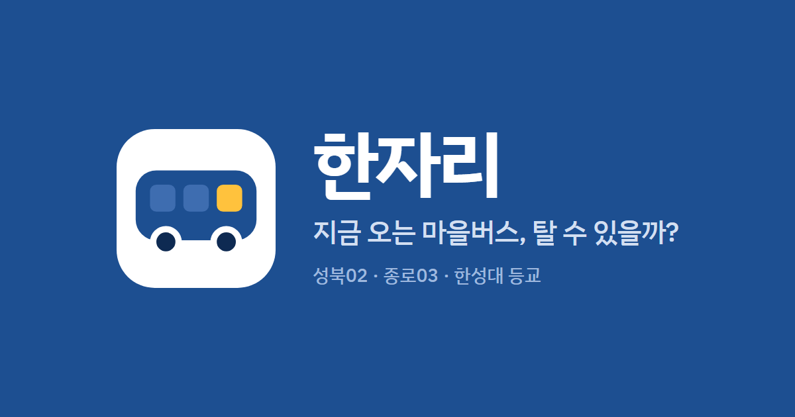
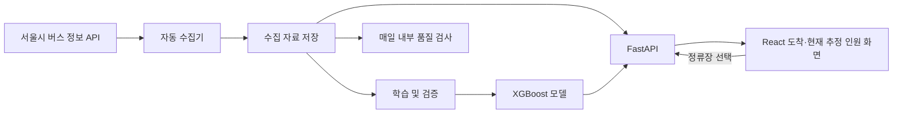

<div align="center">



<br>

**한성대학교 통학생을 위한 버스 도착·차내 인원 안내 서비스**

정류장을 선택하면 첫 번째 도착 예정 버스의 시간과<br>
카드 승하차 집계에 기반한 현재 차내 추정 인원을 확인할 수 있습니다.

<br>


**[🚌 서비스 바로가기](https://161.33.132.80/)**

한성대학교 오픈소스 AI·SW 융합 프로젝트 · **팀 얼리액세스**

[소개](#-프로젝트-소개) · [기능](#-주요-기능) · [실행](#-내-pc에서-실행하기) · [기술](#-기술-및-구조) · [OSS](#-오픈소스와-라이선스) · [검증](#-검증-목표) · [팀](#-팀-소개) · [일정](#-진행-계획)

</div>

---

## 📌 프로젝트 소개

버스가 언제 오는지 알아도 **이번 버스에 탈 수 있을지**는 판단하기 어렵습니다. 차량 안의 승객 수와 내 앞에서 기다리는 사람 수에 따라 탑승 가능성이 달라지기 때문입니다.

한자리는 **도착 시간과 현재 차내 추정 인원**을 안내합니다. 2026-11-02부터 사용자 화면에서 여유 인원·탑승 확률·도착 시 예상 인원·앞 대기 인원 입력을 제거했습니다. 저장된 자료의 품질과 종점 잔여값은 내부에서 매일 검사하며, 실제 인원 검증 없이 미태그로 의심되는 수를 차감하지 않습니다.

### 이용 대상과 범위

| 제공하는 것 | 제공하지 않는 것 |
| --- | --- |
| 성북02·종로03 **등교 방향 정류장 6곳** | 그 밖의 노선·정류장, 하교 방향 |
| 유효한 최신 자료가 있을 때 도착 시간과 현재 추정 인원 | 여유 인원·탑승 확률·미래 인원의 사용자 표시 |
| 지나간 차량·만료된 도착 정보의 표시 중단 | 걸어가는 시간을 포함한 개인별 도착 전 탑승 예측 |
| 저장된 자료로 매일 내부 품질 검사 | 대기열 자동 촬영, 위치 추적, 개인 식별정보 수집 |
| 로그인 없는 모바일·PC 반응형 웹 | 네이티브 앱, 로그인, 결제, 좌석 예약 |

> [!NOTE]
> 현재 인원도 실제로 센 값이 아닌 **카드 집계 기반 추정값**입니다. 하차 미태그 등으로 실제와 다를 수 있으며, 정보가 오래되거나 충돌하면 숫자를 표시하지 않습니다.

## ✨ 주요 기능

| 기능 | 제공 내용 |
| --- | --- |
| 정류장 선택 | 성북02·종로03 등교 방향 6개 정류장 조회, 마지막 선택 정류장 저장 |
| 첫 번째 버스 정보 | 도착 예정 시간, 현재 차내 추정 인원·남은 정류장·갱신 시각 |
| 인원 정보 안내 | ‘현재 차내 인원 · 추정’과 카드 집계의 한계 표시 |
| 내부 품질 검사 | 차량 전환·인원 충돌·종점 차감 가정을 매일 00:50 KST에 저장 자료로 검사 |
| 자동 갱신 | 가까운 버스·갱신 대기는 **5초**, 그 외 **30초** 간격, 오류 시 **60초** 후 재시도 |

### 인원을 숨기거나 갱신을 기다리는 경우

다음 상황에서는 지난 버스의 숫자를 최신 정보처럼 표시하지 않습니다.

- 수집 자료가 **180초를 초과**하면 인원과 도착시간 카운트다운을 숨김
- 차량·제공 시각·인원 형식이 유효하지 않거나 같은 차량의 인원이 충돌하면 인원 보류
- 도착 예정 시각이 지났거나 더 최신 위치로 통과가 확인되면 해당 차량 인원 표시 중단
- 응답이 **8초** 이상 지연되거나 서버 장애가 있으면 상태 안내

### 보완·구현 예정

- [x] **상태 안내 보완**: 수집 지연과 도착 정보 없음 구분, 오래된 인원·도착 안내 숨김
- [ ] **익명 탑승 결과 기록** (10주차): 기록 규칙 확정, API·화면·저장 기능 구현 예정. 참여 동의와 보관기간은 결정 예정
- [x] **HTTPS·설치형 웹 적용**: 인증서·설치 안내·오프라인 복구 확인, API 응답은 오프라인 캐시에 저장하지 않음
- [ ] **두 번째 버스 도착 정보**: 요구사항으로 유지하고 있으며 현재 보류 중

## 🚀 내 PC에서 실행하기

**Python 3.11**이 필요합니다. 저장소를 내려받은 뒤 최상위 폴더에서 실행하세요.

**Windows PowerShell**

```powershell
py -3.11 -m venv .venv
.\.venv\Scripts\python.exe -m pip install -r requirements-runtime.txt
.\.venv\Scripts\python.exe scripts/run_local.py
```

<details>
<summary><b>macOS · Linux</b></summary>

```sh
python3.11 -m venv .venv
.venv/bin/python -m pip install -r requirements-runtime.txt
.venv/bin/python scripts/run_local.py
```

</details>

브라우저에서 [http://127.0.0.1:8000](http://127.0.0.1:8000)을 열면 됩니다. 종료는 `Ctrl+C`입니다.

> [!TIP]
> 기본 실행은 **API 키가 필요 없는 샘플 모드**입니다. 2026년 9월 30일 저장 자료를 사용하므로 현재 버스 상황과는 다르며, 실시간 수집이나 자동 학습은 시작하지 않습니다.

> [!WARNING]
> `hanjari/src/collect.py`(수집기)와 `hanjari-ml/ops/install.sh`는 **운영 서버 전용**입니다. 다른 곳에서 실행하면 API 하루 한도를 넘기거나 시스템 설정이 바뀝니다.

화면 수정과 빌드는 [프론트엔드 개발 안내](hanjari-web/frontend/README.md), 실시간 조회 설정은 [운영 안내](deployment/README.md)를 참고하세요.

## 🛠 기술 및 구조

사용자가 조회할 때마다 외부 버스 API를 호출하지 않고, **미리 수집해 저장한 자료**로 도착 정보와 현재 인원을 제공합니다. 모델 학습·평가와 미태그 차감 가정 검사는 내부 작업으로 유지합니다.



| 구분 | 주요 기술 | 역할 |
| --- | --- | --- |
| Frontend | React · TypeScript · Vite | 정류장 선택, 도착·현재 추정 인원, 반응형 화면 |
| Backend | Python · FastAPI | 저장 자료 조회, 입력 검사, 예측 API 제공 |
| AI / Data | XGBoost · pandas · NumPy · scikit-learn · DVC | 자료 처리, 모델 학습·비교·평가, 데이터 버전 관리 |
| Infrastructure | Oracle Cloud · Ubuntu · systemd | 서비스 배포, 수집·학습 작업 운영 |

내부 예측 모델은 **XGBoost**입니다. 현재 승객 수, 평균 승하차, 정차 중 변화를 이용한 미래 인원·탑승 가능성 계산 코드는 남아 있지만, 현재 사용자 화면에서는 제공하지 않습니다.

API 인원과 실제 인원의 차이가 보고되어 차량 갱신·정원 계산·보류 처리를 수정했습니다. 정원 33·55명은 오프라인 비교용 잠정값이며 차량별 확인 정원이 아닙니다. 재학습으로 확률 표시가 자동 재개되지 않으며, 서버의 예상 인원·확률도 기본 정책에서 null입니다. [원인 조사](hanjari-ml/docs/CAPACITY_FIX_20261102.md)와 [운영 반영·호출 장부 수정 기록](deployment/HOTFIX_20261102.md)을 참고하세요.


### 저장소 구조

```text
HanJari/
├── hanjari/          # 버스 정보 자동 수집기 (운영 서버 전용)
├── hanjari-ml/       # 데이터 처리, 모델 학습·예측, 운영 스크립트
├── hanjari-web/
│   ├── backend/      # FastAPI 예측 API
│   └── frontend/     # React 화면 (dist/는 현재 배포본)
├── deployment/       # 운영 서버 구성 기록과 검증 결과
├── docs/work/        # 파트별 작업 문서
└── scripts/          # 로컬 실행기 (run_local.py)
```

> `hanjari-ml/ops/systemd/`는 설치용 템플릿이고, `deployment/installed/`는 운영 서버에 실제 설치된 설정의 사본입니다.

## 📦 오픈소스와 라이선스

| OSS | 활용 내용 | License |
| --- | --- | --- |
| [XGBoost](https://github.com/dmlc/xgboost) | 도착 승객 수와 예상 범위 예측 | Apache-2.0 |
| [scikit-learn](https://github.com/scikit-learn/scikit-learn) | 날짜별 검증, 오차·확률 평가, 선형 회귀(Ridge) 비교 | BSD-3-Clause |
| [FastAPI](https://github.com/fastapi/fastapi) | 예측 API, 입력 검사, 오류 응답 | MIT |
| [React](https://github.com/facebook/react) | 입력·결과·상태 안내 화면 | MIT |

정확한 버전은 [`requirements-runtime.txt`](requirements-runtime.txt)와 [`package-lock.json`](hanjari-web/frontend/package-lock.json)에 고정되어 있습니다. OSS 원본은 수정하지 않았으며, 프로젝트 활용 예제와 실행 문서를 공개하는 방식으로 기여합니다.

**프로젝트 라이선스:** <!-- TODO: 팀에서 라이선스 결정 후 LICENSE 파일 추가 및 링크 --> `결정 예정`

## 🎯 검증 목표

> [!IMPORTANT]
> 아래 수치는 **프로젝트의 목표이며, 달성 결과가 아닙니다.** 현재까지는 API 자료 수집과 품질 점검을 수행했으며, 실제 탑승 현장 관측은 11주차에 시작합니다.

| 항목 | 목표 |
| --- | --- |
| 예측 성능 | 동일한 독립 평가 자료에서 기준 모델 대비 오차 개선과 확률 신뢰성 확인 |
| 사용자 가치 | 대학생 **10명 이상** 평가, 만족도 평균 **4.0/5.0 이상**. 도착 정보만 제공할 때와 비교해 판단 도움과 입력 부담 확인 |
| 서비스 품질 | 치명적 오류 **0건** |
| 재현 가능성 | 코드·데이터·모델 버전, 실행 방법, 사용 OSS의 버전·라이선스·출처 기록 |

실제 탑승 관측은 **11~12주차에 예측 결과를 보면서** 기록합니다. API 기반 학습 자료와 실제 탑승 평가 자료는 구분해 관리하며, 결과는 성능 달성·성능 미달·검증 미완료로 나누어 보고합니다.

## 👥 팀 소개

**얼리액세스 · EarlyAccess**

| 팀원 | 역할 | 주요 담당 |
| --- | --- | --- |
| 황정원 | PM / 팀장 | 기획·일정·문서·통합, 관측 계획·사용자 평가, 프론트엔드 공동 개발, 백엔드 초기 구현 |
| 서재현 | Frontend / QA | 프론트엔드 공동 개발, UI 설계, 모바일·PC 테스트 |
| 최지용 | AI / Data | API 수집·자료 품질, XGBoost 모델·자동학습, 현장 성능 평가 |
| 유민준 | Backend / OSS | 백엔드, 공개 서비스 운영·배포, OSS·라이선스 관리 |

## 🗓 진행 계획

**1~8주차** ✅ 문제 정의, API 점검, 수집·기준 모델·XGBoost 시제품, 화면·서버 연결을 거쳐 **10/21 중간발표**까지 완료했습니다.

| 주차 | 기간 | 주요 작업 | 상태 |
| :---: | :---: | --- | :---: |
| 9 | 10/26~11/1 | 요구·설계 문서 현행화, 빈 결과·누락 자료 처리 보완, 최신 화면 전체 재시험, 참여 동의·보관기간 결정, 라이선스 결정 | 🔄 |
| 10 | 11/2~11/8 | 익명 기록 기능 구현, 평가용 고정 모델 보관, HTTPS·접근 설정, 현장 관측 계획 | ⏳ |
| 11 | 11/9~11/15 | 실제 탑승 현장 관측 시작, 통합 및 응답 성능 시험, 복구 검증, 이용 불편 개선 | ⏳ |
| 12 | 11/16~11/22 | 현장 관측 마무리, 동일 자료로 모델 비교, 학생 10명 이상 사용자 평가 | ⏳ |
| 13 | 11/23~11/29 | 피드백·오류 반영, 보안·OSS·실행 문서 점검, 현장 성능 평가 정리, 최종 시연·발표 자료 완성, 회고 — **전체 완료** | ⏳ |
| 14~15 | 11/30~12/13 | 예비(일정 지연 대비) · 최종 발표·제출은 수업 일정 | ⏳ |

<sub>✅ 완료 · 🔄 진행 중 · ⏳ 예정 (2026년 기준)</sub>

---

<div align="center">
<sub>Project Charter v1.1(2026.10.27) 기준 · 일정은 [PRD·WBS·마일스톤 v1.1](docs/plan/)(2026.10.28, 13주차 완료) 기준 · 운영 구현 상태 갱신 2026.11.02</sub>
</div>
