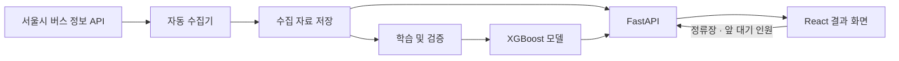

# 한자리 · HanJari

### 지금 오는 마을버스, 탈 수 있을까?

**한성대학교 통학생을 위한 버스 탑승 가능성 안내 서비스**

정류장을 선택하고 내 앞 대기 인원을 입력하면, 첫 번째 도착 예정 버스의 정보와 AI가 예측한 탑승 확률을 확인할 수 있습니다.

한성대학교 오픈소스 AI·SW 융합 프로젝트 · **팀 얼리액세스**

[프로젝트 소개](#프로젝트-소개) · [주요 기능](#주요-기능) · [기술 및 구조](#기술-및-구조) · [팀 소개](#팀-소개) · [진행 계획](#진행-계획) · [개발 문서](#개발-문서)

---

## 프로젝트 소개

버스가 언제 오는지 알아도 **이번 버스에 탈 수 있을지**는 판단하기 어렵습니다. 차량 안의 승객 수와 내 앞에서 기다리는 사람 수에 따라 탑승 가능성이 달라지기 때문입니다.

한자리는 도착 정보에 **차량 혼잡도와 대기 순서를 고려한 탑승 가능성**을 더합니다. 학생이 대기를 계속할지, 다른 이동 방법을 고려할지 판단하도록 돕는 것이 목표입니다.

### 이용 대상과 범위

- **대상:** 지정 정류장에서 버스를 기다리는 한성대학교 통학생
- **노선:** 성북02·종로03의 **등교 방향 정류장 6곳**
- **예측 제공일:** 월~토요일, 공휴일 제외
- **이용 방식:** 로그인 없이 사용하는 모바일·PC 반응형 웹

> 예측 결과는 이동 판단을 돕는 참고 정보이며 실제 탑승을 보장하지 않습니다. 조회 시점에 정류장에서 대기 중인 상황을 기준으로 하며, 정류장까지 걸어가는 시간을 포함한 개인별 탑승 여부는 예측하지 않습니다.

## 주요 기능

**현재 일반 공개 서비스로 운영 중입니다.** 아래 상태는 2026년 10월 19일 구현 자료와 10월 27일 팀 확인을 기준으로 정리했습니다.

| 기능 | 제공 내용 |
| --- | --- |
| 정류장 선택 | 성북02·종로03 등교 방향 6개 정류장 조회 |
| 대기 인원 입력 | 내 앞 대기 인원 **0~40명**의 정수 입력 |
| 첫째 버스 정보 | 도착 예정 시간, 차량·현재 승객 수·남은 정류장·갱신 시각 확인 |
| 탑승 가능성 안내 | 예측 확률과 ‘여유 있음’, ‘빠듯함’ 등의 안내를 결과 카드에 표시 |

정상 상태에서는 **30초마다 자동 갱신**하며, 마지막으로 선택한 정류장을 저장합니다. 수집된 자료가 **180초를 초과**하면 확률과 도착시간 카운트다운을 숨깁니다. 입력 오류·정보 지연·연결 오류 안내도 제공합니다.

### 보완·구현 예정

- **상태 안내 보완:** 운행 종료, 도착 버스 없음, 수집 오류 등 빈 결과의 원인 구분과 최신 화면 전체 재시험
- **익명 탑승 결과 기록:** 기록 규칙은 확정했으며, API·화면·저장 기능은 10주차 구현 예정. 참여 동의와 보관기간은 미정
- **둘째 버스 도착 정보:** 요구사항에 유지하고 있으나 현재 미구현·보류 상태. 재개 일정 미정
- **운영 안정화:** 현재 HTTP로 공개 운영 중이며, HTTPS 적용·접근 설정·복구 검증은 12주차 예정

## 기술 및 구조

사용자가 조회할 때마다 외부 버스 API를 호출하지 않고, **미리 수집해 저장한 자료**로 탑승 가능성을 계산합니다.

| 구분 | 주요 기술 | 역할 |
| --- | --- | --- |
| Frontend | React · TypeScript · Vite | 정류장 선택, 인원 입력, 반응형 결과 화면 |
| Backend | Python · FastAPI | 저장 자료 조회, 입력 검사, 예측 API 제공 |
| AI / Data | XGBoost · pandas · NumPy · scikit-learn | 자료 처리, 모델 학습·비교·평가 |
| Infrastructure | Oracle Cloud · Ubuntu · systemd | 서비스 배포, 수집·학습 작업 운영 |

현재 서비스의 예측 모델은 **XGBoost**입니다. 현재 승객 수와 승하차 관련 정보를 이용해 도착 시 승객 수와 예상 범위를 추정하고, 차량 정원과 앞 대기 인원을 함께 고려해 탑승 가능성을 계산합니다.

**로지스틱 회귀는 학습·비교 실험에 적용**했습니다. 현재 승객 수를 이용한 단순 기준 모델과 비교해 AI의 추가 가치를 검증하며, LightGBM·CatBoost는 대안 후보로 검토합니다.

## 검증 목표

아래 수치는 **프로젝트의 목표이며, 달성 결과가 아닙니다.** 현재까지는 API 자료 수집과 품질 점검을 수행했으며, 실제 탑승 현장 관측은 아직 시작하지 않았습니다.

- **예측 성능:** 동일한 독립 평가 자료에서 기준 모델 대비 오차 개선과 확률 신뢰성 확인
- **사용자 가치:** 대학생 **10명 이상** 평가, 만족도 평균 **4.0/5.0 이상** 목표. 도착 정보만 제공할 때와 비교해 판단 도움과 입력 부담 확인
- **서비스 품질:** 치명적 오류 **0건** 목표. 필수 기능 미구현, 검증 미완료, 성능 목표 미달을 구분해 관리
- **재현 가능성:** 코드·데이터·모델 버전과 실행 방법, 사용 OSS의 버전·라이선스·출처 및 기여 기록 정리

현장 관측 목표와 교대표는 확정했습니다. **11~13주차에 예측 결과를 보면서 실제 탑승 여부를 기록**할 예정이며, API 기반 학습 자료와 실제 탑승 평가 자료는 구분해 관리합니다.

## 팀 소개

**얼리액세스 · EarlyAccess**

| 팀원 | 역할 | 주요 담당 |
| --- | --- | --- |
| 황정원 | PM / 팀장 | 기획·일정·문서·통합, 관측 계획·사용자 평가, 프론트엔드 공동 개발, 백엔드 초기 구현 |
| 서재현 | Frontend / QA | 프론트엔드 공동 개발, UI 설계, 모바일·PC 테스트 |
| 최지용 | AI / Data | API 수집·자료 품질, XGBoost 모델·자동학습, 현장 성능 평가 |
| 유민준 | Backend / OSS | 현재 백엔드 담당, 공개 서비스 운영·배포, OSS·라이선스 관리 |

## 진행 계획

중간발표 이후의 계획입니다. **이미 공개 운영 중인 서비스를 개선하면서 MVP 구현과 검증을 진행합니다.** 날짜는 모두 2026년 기준입니다.

- **9주차 · 10/26~11/1** · 요구·설계 문서 현행화, 빈 결과·누락 자료 처리 보완, 운영 수정본 Git 통합 착수, 최신 화면 전체 재시험
- **10주차 · 11/2~11/8** · 참여 동의·보관기간 결정, 익명 기록 API·화면·저장 기능 구현, 코드·모델 버전 정리와 평가용 고정 모델 보관
- **11주차 · 11/9~11/15** · 실제 탑승 현장 관측 시작, 화면·서버·기록 기능 통합 및 응답 성능 시험
- **12주차 · 11/16~11/22** · HTTPS·접근 설정·복구 검증, 이용 불편 개선, 현장 자료 품질 점검
- **13주차 · 11/23~11/29** · 동일 자료의 모델 비교, 학생 10명 이상 사용자 평가, 공개 운영 결과 검토
- **14주차 · 11/30~12/6** · 피드백·오류 반영, 보안·OSS·실행 문서 점검, 발표 준비 및 최종 시연
- **15주차 · 12/7~12/13** · 최종 발표·제출, 코드·평가 자료·OSS 기록·보고서 정리와 회고

## 개발 문서

- [프론트엔드 개발 안내](hanjari-web/frontend/README.md)
- [운영 안내](deployment/README.md)
- [검증 결과](deployment/VALIDATION.md)
- [기여 안내](CONTRIBUTING.md)
- [오류 제보 및 개선 제안](https://github.com/EarlyAccess-HanJari/HanJari/issues)

---

Project Charter v1.1(2026.10.27)과 팀 확인 사항을 반영했습니다. README 작성일: 2026.10.28.
